# @tian.zuo/pi-antigravity

Use **Google Antigravity** (`agy`) models inside the [pi coding agent](https://pi.dev). pi stays your UI — chat, model picker, tool cards, sessions — while the selected Antigravity model runs underneath through the `agy` CLI.

## Highlights

- **Persistent stream driver** — ordinary user turns reuse one healthy `agy` process; conversation, model, workspace, agent, mode, and bridge changes recycle it safely.
- **Actionable diagnostics** — `/agy-doctor` explains executable selection, checks every candidate and the minimum version, and reports models, driver spawn/recycle counters, bridge revision, conversation database, and display metadata without spending model tokens.
- **Native rendering, not mimicry** — agy's read-only tools (`view_file`, `grep_search`, `find_by_name`, `list_dir`) are re-executed as real pi builtins (`read` / `grep` / `find` / `ls`), so their cards use pi's own renderers and show live, accurate output. Everything else renders through one display-only `antigravity` wrapper.
- **Skills & MCP bridge** — pi-private skills (`~/.pi/agent/skills`, `<project>/.pi/skills`, pi-package installs) are one `pi__activate_skill` tool (pass `{ name }` from the tool's enum), and pi's built-in MCP servers (`mcp.json`, `"exposure": "direct"`) are reachable from agy with pi's permissions, hooks, and rendering. Shared `.agents/skills` roots are agy's own discovery. Each session supplies its bridge through a private workspace MCP configuration.
- **Pi tools mode** — start with `--agy-tools pi` to run a minimal custom agy agent that uses Pi's active tools through the MCP bridge. File access, commands, extension tools, and MCP calls execute in Pi with its hooks, permissions, and rendering.
- **Background-task manager** — long-running agy commands are tracked in a dashboard (`/agy-tasks`) that shows each task's status, pids, and log; `/agy-tasks stop all` reaps the process groups this pi recorded.
- **Artifact browser** — direct conversation files, generated media, and uploads are listed via `/agy-artifacts`; markdown plans/reports have a bounded read-only preview with checklist progress.
- **Model quotas** — `/agy-usage` ports agy's `/usage` into the same Refresh/Close menu as `/usage`: weekly and 5-hour remaining bars per model group, refreshed without spending tokens.

### MCP adapter migration

When an Antigravity model is selected in native tool mode, the extension warns once per session if `pi-mcp-adapter` is loaded. Its tools are no longer bridged, and it replaces Pi's built-in MCP support. Remove or disable the adapter, move your servers to `~/.pi/agent/mcp.json` (or `.pi/mcp.json`) with `"exposure": "direct"`, then run `/reload`. The warning is suppressed when the Pi-tool bridge is disabled.

### Background tasks (`/agy-tasks`)

Long-running commands (dev servers, watchers) become agy background tasks. A hint appears above the editor as soon as the task is detected, without waiting for the agy turn or command to finish:

```text
■ 1 agy background task • /agy-tasks to view
```

Task liveness is detected from the filesystem and the process table. Only a process holding a task's log open counts as proven per-task ownership — everything else is advisory. Recorded orphans (group-leading children recorded against this conversation while its agy was still alive, re-verified by start-time identity on every scan) display as `orphan`, but are never signalled by a per-task stop: nothing can bind a recorded process to one task, since a sibling foreground `run_command` has the same shape. The dashboard therefore offers no stop key at all — on agy ≥ 1.2.0 no process holds the log, so a per-task stop could never prove what it would kill. `/agy-tasks stop all` reaps recorded groups only after their original agy parent has exited — and works even after `/agy reset` cleared the conversation snapshot, sweeping every recorded group this pi owns. A recorded group whose parent is still alive remains `unclear` and is protected as potentially foreground work. Shutdown can reap both attached groups and orphans. These sweeps re-check process identities before signalling, and shutdown escalates the actual PGIDs reached by SIGTERM, including groups whose log holder is not the leader. agy ≥ 1.2.0 pipes task output through itself (nothing holds the log) and runs every `run_command` — foreground or background — as an agy child in its own process group near a task log's birth, so an unclear marker means "this might be your foreground command".

A turn that agy parks on background work ends as soon as the transcript shows its final answer (`AGY_PARKED_WATCH_MS`, default 5s), instead of waiting out the tool stall budget — starting a dev server no longer holds pi for minutes. The distinction also decides what an abort kills: aborting a turn whose command is still in the foreground (Esc) reaps that command's process group, while a task agy already backgrounded keeps running — the turn was aborted, not the work. When pi exits, detached task groups and proven orphans get SIGTERM, then SIGKILL on any group still holding members — closing pi does not leave `sleep`/dev-server processes running.

agy itself offers no usable stop channel for a task started from pi, which is why the sweep above is signal-based. `/tasks` is interactive-only (`agy --print /tasks` is refused: "not available in print mode"), the TUI panel it opens is read-only (navigate and view output, no kill key), and the model-facing `manage_task` tool only kills from the process that owns the task — a fresh agy process resuming the conversation answers "already been stopped" while the task keeps running (verified on 1.2.2). agy's own cleanup (`terminating N background task(s) on exit`) runs in print mode only: in the persistent stream-json process a task always outlives agy, so pi's own sweeps are the only thing that ends it.

### Artifacts (`/agy-artifacts`)

Images and files agy creates land in a per-conversation artifact store. A hint appears when new ones exist:

```text
◆ 1 agy artifact • /agy-artifacts to view
```

### Model quotas (`/agy-usage`)

agy's interactive `/usage` (alias `/quota`) is a TUI-only slash command — there is no `agy usage` subcommand. `/agy-usage` expands the same slash command in print mode (`agy --print /usage --output-format json`), which returns structured quota groups and reports zero tokens.

```text
Gemini Models
  5h limit:         [████████████████████] 98% left · resets 19:53

  Weekly limit:     [███████████████████░] 97% left · resets 09:10 on 4 Sep

Claude and GPT models
  5h limit:         [████████████████████] 100% left · resets 20:08

  Weekly limit:     [████████████████████] 100% left · resets 15:08 on 4 Sep
```

## Pi tools mode

Use `/agy tools on` to enable Pi tools and `/agy tools off` to return to native tools. `/agy tools` toggles the mode; `/agy tools status` shows it. `/agy-tools [on|off|status]` provides the same controls. Each successful toggle saves `antigravity.toolMode` in Pi's user-level `settings.json`, so the choice survives `/reload`, restart, and resume. Explicit `on` or `off` also saves the preference when that mode is already active. Switching waits for an active run to finish, rebuilds the agy conversation and bridge, and preserves Pi history. If preparation or saving fails, the previous mode and saved preference remain in effect.

The saved setting lives under `~/.pi/agent/settings.json` (or `PI_CODING_AGENT_DIR`):

```json
{
  "antigravity": {
    "toolMode": "pi"
  }
}
```

The footer shows `pi-tools:on` or `pi-tools:off` while an Antigravity model is selected, matching Devin ACP's compact fast-mode indicator. It updates after toggles and reloads and disappears when leaving Antigravity.

You can also choose the model normally and select Pi tools at startup:

```sh
pi --provider antigravity --model claude-sonnet-4-6 --agy-tools pi
```

Alternatively, set `PI_ANTIGRAVITY_TOOLS=pi`. Startup precedence is `--agy-tools` → `PI_ANTIGRAVITY_TOOLS` → saved `antigravity.toolMode` → `native`. Startup overrides do not change the saved preference; the toggle commands save it.

Pi tools mode starts a custom agent directly with `agy --agent`; it does not create a parent agent to relay messages. The agent declares `tools: []`, disables ambient agy customizations, and configures only the current session's authenticated Pi bridge. Antigravity adds its MCP dispatcher/resource tools and fundamental task-management tool; ordinary native file, shell, web, and editing tools are not configured. Work goes through the active Pi tool set, including builtins such as `read`, `bash`, `edit`, and `write`, extension tools, and MCP tools. Inactive/hidden tools and the display-only replay wrapper stay out. Bridged `codemode` and `tool_search` retain Pi's own tool discovery and execution behavior.

This mode relays the current Pi instructions, including project and user guidance and the loaded skill catalog. Skills are loaded using Pi tools rather than the native mode's virtual `activate_skill` reader. Each bridge call becomes a real Pi tool call, so Pi's hooks, permission checks, tool selection, and results apply before agy continues. If the bridge or agent cannot be prepared, the request fails instead of starting the default agent. `PI_ANTIGRAVITY_AGENT` cannot be combined with Pi tools mode, and the bridge must be enabled.

The session-owned agent configuration lives under `~/.gemini/config/agents/` and is removed when leaving Antigravity or shutting down. Ordinary turns reuse the persistent agy process. Resuming or reloading a Pi session starts a fresh agy conversation and restores Pi history, binding it to the current bridge and avoiding an older native-tool conversation. `/agy` and `/agy-doctor` show the selected tool mode.

## Private MCP discovery

Both tool modes write the authenticated bridge configuration under `~/.pi/agent/antigravity/bridges/<instance>/.agents/mcp_config.json` (or the configured Pi agent directory). Each agy child receives only that instance's directory through an extra `--add-dir`; its working directory remains the project. The extension does not register, remove, or prune servers in agy's global MCP configuration.

Tools have stable names such as `pi__read`, `pi__tool_search`, and `pi__activate_skill`. Each instance keeps a short, unique server name for routing and agy's descriptor cache. Mode changes, provider switches, and shutdown remove only the instance's private configuration and descriptor-cache key. Failed preparation closes the listener and removes partial configuration; concurrent startup shares one preparation. Saved native conversations are bound to their bridge instance; restarting or reloading with new private discovery rebuilds the conversation from Pi history.

This isolates the bridge supplied by each Pi instance. Native agy can still load your existing global MCP servers, and live bridge registrations from older extension versions remain global until those sessions stop. Restart older Pi sessions when upgrading to private discovery.

## Context and permissions

The first agy turn receives the active Pi conversation history, including earlier work with another provider. `/agy-reset` deliberately starts fresh without replaying that history; it does not delete the Pi transcript. A later provider switch or branch move can restore the active history again.

Pi's system instructions are relayed on the first native turn, after a native conversation restore, and when they change. Unchanged instructions are not repeated on each turn or tool-loop re-entry; removing them sends an explicit clearing notice. Unacknowledged instruction and skill-catalog updates are retained across stall retries. Disposable summaries receive their own instructions without changing the live conversation.

**Pi instructions are relayed as text, not a native system role.** agy's CLI has no system-prompt input, so the relay is a labeled user-prompt snapshot. In native tool mode it is deliberately minimal: only pi's documentation paths, rebuilt from the installed pi package. Everything else in pi's rendered system prompt is dropped by design: pi's tool inventory and guidelines describe tools agy cannot call, workspace `AGENTS.md`/`GEMINI.md`/`.agents/rules` files are agy's own native discovery, skills arrive through the `activate_skill` bridge, and user-authored pi customizations (`customPrompt`, `appendSystemPrompt`) configure the pi agent — not agy. Summarization requests keep their own caller instructions untouched.

**In native tool mode, native agy tools bypass Pi's pre-execution permission hooks.** Both execution modes always pass `--dangerously-skip-permissions` because headless agy otherwise denies permission prompts. Native commands, file edits, browser actions, and reads execute inside agy; their Pi cards are replayed afterward. Blocking or disabling a Pi tool cannot prevent a native operation that already happened. Only tools routed through the Pi bridge execute under Pi's hooks and permissions. Use this extension only where you trust agy's access to the workspace; the replay UI is not a security boundary.

## Commands

| Command          | What it does                                                                                                    |
| ---------------- | --------------------------------------------------------------------------------------------------------------- |
| `/agy`           | Conversation title/status; `/agy tools [on|off|status]` controls and saves the tool mode                         |
| `/agy-tools`     | Toggle and save Pi tools; `on` enables them, `off` restores native tools, and `status` shows the mode              |
| `/agy-reset`     | Drop the agy conversation and driver; next turn starts fresh                                                    |
| `/agy-models`    | Re-discover models and re-register the provider                                                                 |
| `/agy-agents`    | List configured custom agy agents without inference                                                             |
| `/agy-doctor`    | Diagnose all binary candidates/selection, models, driver spawn/recycle counters, bridge, and conversation state |
| `/agy-subagents` | List live subagent activity observed on the agy stream (spawns, messages, kills) — no model tokens             |
| `/agy-tasks`     | Background-task dashboard (`stop <task-id> \| all` for scripts)                                                 |
| `/agy-artifacts` | Artifact browser (`open <name>` for scripts)                                                                    |
| `/agy-usage`     | Model quotas (weekly and 5-hour remaining per group)                                                            |

## Configuration flags

| Flag                                     | Effect                                                                                                                                       |
| ---------------------------------------- | -------------------------------------------------------------------------------------------------------------------------------------------- |
| `PI_ANTIGRAVITY_PI_TOOL_BRIDGE=0`        | Turn the bridge off. pi-private skills become unavailable to agy (a one-time warning); shared `.agents` skills still reach agy natively.       |
| `PI_ANTIGRAVITY_DRIVER=0`                | Operational rollback: spawn one `agy --print` process per logical turn. Its stall watchdog is pure inactivity — no liveness or parked-turn probing — so a quiet tool or parked background task still dies at `AGY_TOOL_STALL_TIMEOUT_MS`. |
| `PI_ANTIGRAVITY_TOOLS=native\|pi`        | Select the tool mode at startup; overridden by `--agy-tools`. Pi mode runs work through the session's Pi tools.                              |
| `PI_ANTIGRAVITY_AGENT=<name>`            | Select a custom agy agent in native tool mode. Empty, control-character-containing, and overlong values are rejected before spawn.          |
| `PI_ANTIGRAVITY_MODE=plan\|accept-edits` | Select agy's stable CLI execution mode. Other values fail before spawn.                                                                      |
| `AGY_BINARY=/path/to/agy`                | Strictly use a specific agy binary; no fallback if it fails.                                                                                 |
| `AGY_TURN_TIMEOUT_MS=600000`             | Pi-owned overall budget for one logical turn, including startup, fallback, stall retries, and backoff. Retries receive only the remaining budget. Persistent mode sets agy's separate `--print-timeout` above Node's maximum timer budget so its default five-minute wait cannot silently end a live turn; Pi's deadline and abort still stop the process.                                  |
| `AGY_STALL_TIMEOUT_MS=120000`            | Kill the turn when the stream produces no bytes for this long and retry by resuming the conversation. `0` disables the watchdog.             |
| `AGY_TOOL_STALL_TIMEOUT_MS=300000`       | Stall budget while a tool step is ACTIVE — a quiet foreground tool is legitimate, so silence inside a tool gets a longer leash. The transcript is checked long before this budget expires (`AGY_PARKED_WATCH_MS`): if agy already finished its answer but is parked on background work (it holds `result` until every task exits, bounded by the ~25-day `--print-timeout`), the turn ends after a short parked grace — the still-ACTIVE step surfaces as an incomplete-tool card pointing at `/agy-tasks`. Otherwise a `ps` check extends the budget while a live process-group-leading agy child proves real work (up to 12 consecutive budgets; a completed tool resets the count). During each extended budget the transcript is checked every 10 seconds without consuming extra liveness graces; a known final answer skips any parked grace that would cross the turn deadline. Transcript reads expand from 64 KiB to at most 8 MiB to recover complete large JSONL responses. Tools that spawn nothing (`schedule`, `search_web`) have no such evidence, so this timeout remains their bound. |
| `AGY_PARKED_WATCH_MS=5000`               | How often to poll the transcript for a final answer agy is withholding while a tool step is ACTIVE. agy says nothing on stdout for the whole life of a background task, so without this watch a parked turn would hold pi for the full tool budget (~5 minutes) after the answer was already written; the same watch is what tells the driver a task is background work, so aborting the turn leaves it running. `0` restores budget-only detection. |
| `AGY_STALL_RETRY_BACKOFF_MS=3000`        | Pause before each stall retry. Stalls retry at most twice, rendered as a collapsed "agy stream stalled … restarting the turn" thinking line. |

## Terms of Service & account safety

This extension never talks to Google's servers itself. Authentication, tokens, and all API access stay inside the official first-party `agy` CLI; this extension only drives its supported stream-json/`--print` interface and renders the output inside pi. OAuth credentials never leave the official client.

This matters because Google's [Antigravity Terms of Service](https://antigravity.google/terms) explicitly prohibit accessing the service through third-party software, and the [official FAQ](https://antigravity.google/docs/faq) names third-party coding agents as grounds for suspension — Google's recommended path for third-party agents is a Vertex AI or AI Studio API key. In February 2026 Google ran automated 403 suspension sweeps against accounts (including paid subscribers) whose credentials were used by reverse-engineered clients hitting the private `cloudcode-pa.googleapis.com` API.

In practice: extensions that reimplement Antigravity's private API with extracted OAuth client IDs put your Google account at real risk of permanent suspension. This extension avoids that class of violation by design, though driving the official CLI programmatically is automation Google has not explicitly licensed.

## Development

Reference: [Pi-cursor-sdk](https://github.com/fitchmultz/pi-cursor-sdk)

## How it works

```mermaid
flowchart TB
    subgraph pi["pi coding agent (the UI)"]
        UI["You: chat, tool cards,\npermissions, sessions"]
        Prov["antigravity provider\n(persistent stream-json driver)"]
        Native["pi builtins\n(read / grep / find / ls)\nre-execute read-only steps"]
        Bridge["skills & MCP bridge\n(local MCP server on 127.0.0.1)"]
        Skills["pi-private skills\n(.pi trees)"]
        Mcp["pi MCP servers\n(builtin:mcp, exposure: direct)"]
    end

    subgraph agy["agy CLI (the agent loop)"]
        Agent["Antigravity model\nbuilt-in tools\n(one process across user turns)"]
        Summary["Disposable agy process\nPi summaries only"]
    end

    UI <-- "stream events:\ntext, tool cards, usage" --> Prov
    Prov -- "NDJSON user events:\n--input-format stream-json" --> Agent
    Prov -. "compaction / branch summary" .-> Summary
    Agent -- "read-only step done:\nemit native toolCall" --> Native
    Prov -- "mutating/specialty step done:\ndisplay-only antigravity card" --> UI
    Agent -- "wants a skill or pi MCP tool:\ncall pi__<name> (MCP)" --> Bridge
    Bridge -- "route into live turn" --> Prov
    Prov -- "stopReason: toolUse" --> UI
    UI -- "pi executes the REAL tool" --> Mcp
    Mcp -- "result" --> Prov
    Prov -- "result back to agy" --> Bridge
    Skills -- "pi-private skills become\npi__activate_skill" --> Bridge
```



## Release notes

Release notes and logs: [changelog](https://github.com/TianZuo555/pi-extensions/blob/main/packages/pi-antigravity/CHANGELOG.md) · [GitHub releases](https://github.com/TianZuo555/pi-extensions/releases)
